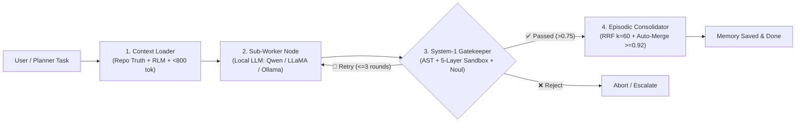
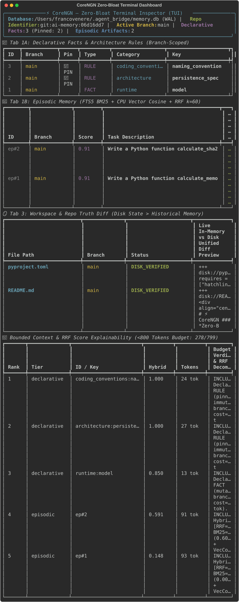
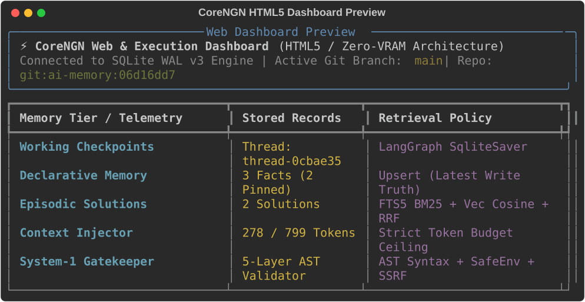

<div align="center">

# ⚡ CoreNGN
### *Zero-Bloat, Local-First Agent Memory & Dual-Core LangGraph Orchestration*

[](https://github.com/frankycode96/CoreNGN/actions)
[](https://www.python.org/downloads/)
[](https://www.sqlite.org/wal.html)
[](#zero-vram-guarantee)
[](https://opensource.org/licenses/MIT)

*Stop letting runaway prompts eat your local LLM's KV-cache. CoreNGN gives your local coding agents structured long-term memory, sub-millisecond AST gating, and surgical context retrieval—without allocating a single megabyte of GPU VRAM.*

[Why CoreNGN?](#the-problem-were-solving) • [Architecture](#how-it-works-under-the-hood) • [Quickstart](#get-started-in-60-seconds) • [CLI Commands](#command-line-toolkit) • [OMP Integration](#working-with-omp--local-runtimes)

---

</div>

## 💡 The Problem We're Solving

If you've ever tried running local agentic workflows with **Ollama**, **llama.cpp**, or **vLLM**, you've probably hit the same wall:

1. **Context Bloat Kills Local Models:** When you dump 4,000 tokens of chat logs and file dumps into a 7B or 27B model, generation slows down, KV-cache consumes precious VRAM, and the model starts hallucinating or writing `# TODO: implement this`.
2. **Memory Rot (The Telephone Game):** Summarizing past conversations recursively distorts intent over time. The agent forgets what was actually merged into the codebase.
3. **Heavy Vector Databases Waste Compute:** Running Postgres+pgvector, Milvus, or Chroma in Docker containers alongside your local LLM wastes RAM and CPU cycles you actually need for inference.
4. **No Code Safety Net:** Local models occasionally try to `eval()`, write destructive bash commands, or forget imports.

**CoreNGN fixes this with a clean, local-first philosophy:**
- 📦 **A single embedded SQLite WAL database** (`~/.agent_bridge/memory.db`) with BM25 (FTS5) and CPU float32 vectors (`sqlite-vec`).
- 🎯 **Strict < 800 Token Context Budget:** Your model only receives what it needs right now.
- 🛡️ **Sub-millisecond System-1 Gatekeeper:** Pre-flight AST syntax validation, anti-placeholder checks, and a 5-layer sandbox run in `< 1.5ms` on CPU before anything is saved or executed.
- 🌿 **Git-Branch Isolation:** Memories created on `feature/auth` never leak into `main`.

---

## 🧠 How It Works Under the Hood

CoreNGN separates **deliberation (System 2)** from **validation and memory (System 1)**:



### The 4 Memory Tiers (SQLite v3)

| Tier | Backing Mechanism | What It Stores | Eviction / Scope |
| :--- | :--- | :--- | :--- |
| **Working Memory** | LangGraph `SqliteSaver` | Step-by-step thread execution state | Ephemeral per task thread |
| **Declarative Memory** | SQLite table + Audit Log | Architectural `RULE`s, `FACT`s, `PREFERENCE`s | Pinned or branch-scoped; automatic 30-day TTL for `BELIEF`s |
| **Episodic Memory** | FTS5 (BM25) + `sqlite-vec` + RRF ($k=60$) | Validated `(Task, Final_Artifact)` pairs | Auto-consolidated (`cosine >= 0.92`), pruned when stale |
| **Thought Journal** | `reasoning_journal` table | Multi-step reasoning trace & confidence | Decoupled from artifact search to prevent prompt clutter |

### Absolute Truth Hierarchy
When there's a conflict between what was said in the past and what's on disk today, CoreNGN enforces an unambiguous rule:
$$\mathbf{Repo\ State\ (Live\ Disk)} \;\;>\;\; \mathbf{Declarative\ Rules\ (RULE)} \;\;>\;\; \mathbf{Episodic\ Memories}$$

---

## 🚀 Get Started in 60 Seconds

### 1. Installation

```bash
# Clone the repository
git clone https://github.com/frankycode96/CoreNGN.git
cd CoreNGN

# Set up virtual environment with uv (fastest) or standard venv
uv venv --python python3.11 .venv
source .venv/bin/activate
uv pip install -e ".[dev,all]"
```

### 2. Run Pre-Flight Diagnostics

CoreNGN automatically scans your local network for active inference engines:

```bash
agentic init --seed-defaults
agentic doctor
```

It probes **Ollama** (`:11434`), **llama.cpp** (`:8080` / `:8020`), and **vLLM/LM Studio** (`:1234`), verifies SQLite WAL triggers, checks your active Git branch, and ensures zero VRAM is being leaked.

---

## 🛠️ Command-Line Toolkit

CoreNGN comes with a zero-bloat CLI designed for developer ergonomics:

```bash
# 🎯 Run an autonomous task with automatic Gatekeeper checks
agentic run "Write a Python function calculate_sha256_checksum(path: str) -> str reading in chunks"

# 📌 Pin an architectural rule (protected against overwrites)
agentic memory upsert coding_conventions orm "SQLAlchemy 2.0 async only" --type RULE

# 💡 Store a temporary hypothesis with a 30-day self-destruct TTL
agentic memory upsert hypothesis active_port "8020" --type BELIEF --ttl-days 30

# 🔍 Surgical RLM file inspection (without loading 5,000 lines into the model)
agentic rlm peek src/agent_bridge/memory/episodic.py --start-line 104 --end-line 129
agentic rlm search "compute_normalized_rrf"

# 📊 Explain why specific memories won the < 800 token budget (RRF + BM25 + Cosine)
agentic explain "calculate_sha256_checksum"

# 🧹 Consolidate near-duplicate episodic memories (cosine >= 0.92)
agentic consolidate --threshold 0.92

# 🗑️ Garbage-collect stale memories and expired BELIEF facts
agentic prune --older-than 30 --min-score 0.50

# 🖥️ Launch the Zero-Bloat Terminal UI (or get a rich text snapshot)
agentic tui
agentic inspect

# ⚡ Run the 100-iteration latency & RAM footprint benchmark
agentic benchmark --iterations 100 --format both
```

---

## 🖥️ Interactive Terminal UI (TUI) & HTML5 Dashboard

CoreNGN rejects heavy Electron apps and bulky multi-container web stacks. It provides an ultra-fast full-screen terminal dashboard built on `textual` / `rich`, alongside a standalone HTML5 export:

### 1. Zero-Bloat Terminal Dashboard (`agentic tui` / `agentic inspect`)

<div align="center">
  
</div>

- 🧭 **Memory Explorer (Tabs 1A & 1B):** Live browsing and hotkey curation (`pin`, `unpin`, `forget`) across Declarative Rules and Episodic Solutions.
- 🔬 **RRF & Token Budget Explainability:** Transparent score breakdown explaining exactly why an item won the `< 800` token context injection.
- 🪞 **Repo Truth Diff (Tab 3):** Real-time diff inspector comparing in-memory state against live files on disk to catch drift immediately.

### 2. Standalone HTML5 Dashboard (`assets/dashboard.html`)

For teams sharing state reports or running on headless CI machines, CoreNGN exports a zero-dependency HTML5 dashboard:

<div align="center">
  
</div>

> Open `assets/dashboard.html` in any browser to inspect telemetry, budget usage, and declarative facts with zero server processes.

## 🤝 Working with OMP & Local Runtimes

CoreNGN was engineered to power **Hierarchical Planner-Executor** architectures like **OMP** (Oh My Pi / Open Multi-Agent Platform):

- **Cloud Planner (e.g. Gemini 4 Argon / Gemini 3.8 Flash):** High-level architectural reasoning, decomposing projects into micro-tasks.
- **Local Executor (e.g. Qwen 3.8 27B / LLaMA 3.1 8B via llama-swap / Ollama):** Fast, local code writing on your GPU.
- **CoreNGN (The Bridge):**
  1. Trims the context before it reaches the local model to **under 800 tokens** using RLM peek/search.
  2. Blocks syntax errors, dangerous `eval`/`os.system` calls, and `# TODO` placeholders via the 5-layer sandbox.
  3. Caches validated solutions with RRF ($k=60$) so future sub-tasks build on past work deterministically.

---

## 🧪 Testing & Verification

CoreNGN ships with an exhaustive, zero-mock test suite:

```bash
pytest -v
```

```text
======================== 28 passed in 1.56s ========================
```

Every single component—from cross-platform `sqlite-vec` loading (macOS ARM64, Linux x86_64), AST sandboxing, RRF ranking math, Git branch isolation, to 4-node LangGraph FSM convergence—is deterministically verified on every commit.

---

## 📜 License

CoreNGN is open-source software licensed under the **[MIT License](LICENSE)**.
Created for developers who believe local AI should be fast, private, and deterministic.
