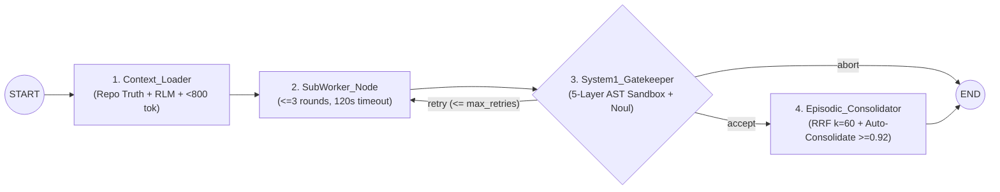

# CoreNGN (hybrid-memory-engine)

**Zero-Container Local-First 4-Tier Memory & System-1 / System-2 Hierarchical LangGraph Orchestration Framework.**

Designed for real-time reliability on consumer/prosumer hardware running local quantized inference servers (**Ollama**, **llama.cpp**, **vLLM**) under strict VRAM and KV-cache constraints.

---

## Architectural Pillars

1. **Zero-Container Local-First Persistence (`LocalMemoryEngine` - SQLite v3)**
   - Unifies all memory tiers and audit trails into a single embedded SQLite file (`~/.agent_bridge/memory.db`) in **WAL** mode (`synchronous=NORMAL`, `busy_timeout=5000ms`).
   - **Git-Branch Scoped Persistence**: Automatically resolves active Git repository and branch (`git rev-parse --abbrev-ref HEAD`), isolating unmerged feature branches.
   - **Working Memory**: Atomic graph checkpoints via LangGraph's `SqliteSaver`.
   - **Declarative Memory (6-Type Taxonomy & TTL)**: Supports `FACT`, `BELIEF` (auto 30-day TTL expiration), `PREFERENCE`, `IDENTITY`, `RULE` (auto-pinned as immutable), and `EXPERIENCE`. Every mutation is tracked deterministically in `memory_audit_log`.
   - **Episodic Memory (FTS5 + CPU Vector + RRF $k=60$)**: Hybrid ranking combining BM25 lexical search and CPU `float32` cosine similarity via Reciprocal Rank Fusion ($k=60$). Stores only validated `(Task, Final_Artifact)` pairs.
   - **Bounded Context Injector**: Guarantees a hard context budget (`< 800 tokens`) enforcing **Repo Truth Hierarchy > Declarative Memory > Episodic Memory**.
   - **Thought Journal (`ReasoningJournalStore`)**: Decoupled `reasoning_journal` tracking macro-FSM reasoning checkpoints and System-1 Noul confidence per `thread_id` without polluting episodic memory.

2. **System-1 / System-2 Dualism & 5-Layer Security Sandbox**
   - Generative LLMs (*System 2*) are reserved **exclusively** for artifact synthesis.
   - *System 1* heuristic controller (`LocalHeuristicDecisionEngine`) evaluates syntax, AST integrity, anti-placeholders, and security gating in sub-millisecond cycles:
     - `Choice(state, question, options)` $\rightarrow$ chosen option + normalized Softmax distribution.
     - `Score(state, question, scale_rubric)` $\rightarrow$ normalized scalar in $[0.0, 1.0]$.
     - `Noul(state, proposition)` $\rightarrow$ epistemic truth probability in $[0.0, 1.0]$.
   - **5-Layer Security Sandbox (`CodeSandboxValidator`)**:
     - *Layer 1 (Static AST)*: Blocks `eval`, `exec`, `compile`, `__import__`, `os.system`, `shutil.rmtree`.
     - *Layer 2 (Import Blocklist)*: Blocks `ctypes`, `pickle`, `marshal`, `pty`, `fcntl`.
     - *Layer 3 (`SafeEnv`)*: Strips sensitive credentials (`*KEY*`, `*TOKEN*`, `*SECRET*`).
     - *Layer 4 (SSRF Guard)*: Blocks cloud metadata IPs (`169.254.169.254`) and dangerous URI schemes.
     - *Layer 5 (Resource Cap)*: Enforces 100 KB max output limit and execution timeouts.

3. **Deterministic Sub-Worker Isolation & RLM Repo Truth Inspector**
   - Encapsulates exploratory multi-turn synthesis inside `SubWorker_Node` with zero shared state, strict round cap (`max_round <= 3`), 120s timeout, and immediate scratchpad eviction (`scratchpad.clear()`).
   - **RLM Workspace Toolkit (`RLMWorkspaceToolkit`)**: Surgical code inspection tools (`peek`, `search`, `chunk`, session scratchpad) to ground prompts directly in the filesystem under the `< 800 token` budget.

4. **Anti-Memory-Rot Curation, Semantic Auto-Consolidation & TUI**
   - **Semantic Auto-Consolidation**: Merges near-duplicate episodic artifacts (`cosine >= 0.92`) retaining the highest-quality artifact and unifying tags.
   - **Memory Curation (`MemoryCurator`)**: `pin`, `unpin`, `forget`, `prune` (with expired-BELIEF TTL cleanup and `--dry-run`), and `explain` (BM25 + Vector + RRF score decomposition).
   - **Zero-Bloat Terminal UI (`AgentBridgeTUI`)**: Full-screen `textual` and `rich` terminal dashboard (*Memory Explorer*, *Live Graph Tracer*, *Workspace & Repo Truth Diff*).
   - **Universal Runtime Auto-Discovery (`RuntimeDetector`)**: Non-blocking discovery of Ollama, llama.cpp, and vLLM/LM Studio.
   - **On-Device Benchmark (`BenchmarkRunner`)**: Profiles latency, TTFT, throughput, and RSS RAM / disk growth over 100 synthetic iterations.

---

## Macro-FSM Topology



---

## Quick Start (Local-First)

### 1. Installation

```bash
uv venv --python python3.11 .venv
source .venv/bin/activate
uv pip install -e ".[dev,all]"
```

### 2. Initialize & Run Pre-Flight Diagnostics

```bash
agentic init --seed-defaults
agentic doctor
```

### 3. Memory Curation, RLM Tools & Execution

```bash
# Upsert declarative fact with 6-type taxonomy & TTL
agentic memory upsert runtime inference_backend "ollama/qwen2.5-coder:7b" --type RULE
agentic memory upsert hypothesis active_port "8080" --type BELIEF --ttl-days 30

# Consolidate near-duplicate episodic memories (cosine >= 0.92)
agentic consolidate --threshold 0.92

# Surgical RLM inspection of codebase files
agentic rlm peek src/agent_bridge/memory/episodic.py --start-line 104 --end-line 129
agentic rlm search "compute_normalized_rrf"

# Inspect structured Thought Journal checkpoints
agentic journal --limit 10

# Execute the 4-node LangGraph FSM
agentic run "Write a Python function calculate_token_budget that estimates token usage"

# Explain exact BM25 + CPU Vector + RRF scoring
agentic explain "calculate_token_budget"

# Prune outdated or low-salience memories and expired BELIEF facts
agentic prune --older-than 30 --min-score 0.50 --dry-run

# Launch the Zero-Bloat Terminal UI
agentic tui

# Execute the 100-run on-device benchmark
agentic benchmark --iterations 100 --format both
```

### 4. Run the Deterministic Test Suite

```bash
pytest -v
```

## Core Capabilities & Architectural Advantages

### 1. Deterministic Auto-Repair & Sandboxed Sub-Workers
* **Isolated Multi-Agent Sandbox:** Encapsulates exploratory multi-agent collaboration (such as Coder and Critic workflows) within isolated sub-worker nodes[cite: 1, 2].
* **Execution Guardrails & Circuit Breakers:** Restricts conversational loops with strict turn limits (`max_round`) and execution timeouts to eliminate token explosion and prevent orchestrator blocking[cite: 1, 2].
* **Clean State Hand-Off:** Ensures the sub-worker extracts and returns only the final converged, validated artifact to the primary state machine[cite: 1, 2].
* **Immediate Scratchpad Eviction:** Completely flushes and discards the internal conversational buffer upon node completion, preventing intermediate noise from causing context stuffing[cite: 1, 2].

### 2. Multi-Tier Memory Persistence & Zero Semantic Drift
* **Decoupled 4-Tier Memory:** Organizes state across Working, Declarative, Semantic, and Episodic persistence layers to eliminate monolithic prompt bloating[cite: 1, 3].
* **Clean Episodic Storage:** Persists exclusively converged problem-solution pairs while aggressively pruning intermediate trial-and-error traces and failed attempts[cite: 1, 3].
* **Mitigation of the "Telephone Game":** Prevents recursive summarization loss and semantic drift by avoiding continuous lossy compression of active chat dialogues[cite: 3].
* **Ingestion Garbage Collection:** Automatically strips raw tool invocations, syntax errors, and internal reasoning traces before records reach long-term storage[cite: 1, 3, 5].

### 3. Absolute Truth Hierarchy (`Repo State > Memory`)
* **Background Context Demotion:** Treats retrieved memories strictly as background context rather than rigid, overriding instructions[cite: 1, 5].
* **Disk Primacy:** Enforces that the live state of code files on disk within the repository always takes precedence over historical memory whenever conflicts arise[cite: 1, 5].
* **Hallucination Suppression:** Eliminates phantom memories and outdated architectural assumptions when codebase implementations evolve across sessions[cite: 1, 5].

### 4. Sub-Millisecond System-1 Decision Controller
* **Deterministic Pre-Flight Checks:** Executes syntax validation via AST parsing and typed heuristic evaluations before dispatching generative LLM queries.
* **Instantaneous Gating:** Resolves state routing and stopping criteria in sub-millisecond cycles on CPU, delivering significant speedups over generative round-trips.
* **GPU Compute Reservation:** Leaves GPU cores and VRAM unburdened by routine classification tasks, reserving compute strictly for generative code synthesis.

### 5. Resource Efficiency & Zero-VRAM Footprint
* **Zero-VRAM Persistence:** Runs persistence operations, lexical search (BM25), and CPU embeddings entirely in-process without allocating GPU VRAM[cite: 1].
* **KV-Cache Optimization:** Enforces strict context budget ceilings (< 800 tokens), preventing context window saturation and attention degradation[cite: 1, 3].
* **Container-Free Deployment:** Eliminates mandatory external server stacks (e.g., PostgreSQL, Redis, standalone vector DBs) in local-first environments in favor of embedded storage[cite: 1].

### 6. Git-Awareness & Branch-Scoped Isolation
* **Branch-Context Tracking:** Automatically associates declarative rules and episodic solutions with the active Git branch and repository identifier.
* **Cross-Branch Quarantine:** Isolates unmerged feature-branch memories from contaminating the main trunk branch.
* **Asymmetric Inheritance:** Permits experimental feature branches to inherit baseline trunk conventions while preventing unverified assumptions from polluting global state.

### 7. Explicit Memory Curation & Human-in-the-Loop Control
* **Native Checkpointing & Time Travel:** Leverages state checkpointing to allow pausing execution, inspecting states, and rolling back steps retroactively[cite: 1, 2, 3].
* **Immutable Pinning:** Allows developers to pin critical architectural rules to guarantee they cannot be overwritten by automatic compaction or LLM updates[cite: 1].
* **Deterministic Deletion:** Provides explicit deletion mechanisms to atomically purge obsolete memories across relational and search indices[cite: 1, 5].
* **Retrieval Explainability:** Exposes exact score breakdowns detailing lexical BM25 matching, vector cosine similarity, and recency decay contributions.

### 8. Flexible Deployment & OMP Ecosystem Interoperability
* **Standalone Local Operation:** Runs self-contained on a single developer machine with zero network dependencies[cite: 1].
* **Asymmetric Exobrain Setup:** Operates as a centralized memory daemon serving remote execution environments and coding agents over lightweight HTTP APIs[cite: 1, 5].
* **OMP (Oh My Pi) Integration:** Integrates with terminal workflows by mirroring OMP native memory principles (`mnemopi`, `local`, and `hindsight`)[cite: 1, 5].
