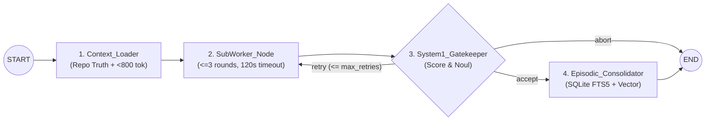

# Hybrid Agent Bridge (`hybrid-agent-bridge`)

**Zero-Container Local-First 4-Tier Memory & System-1 / System-2 Hierarchical LangGraph Orchestration Framework.**

Designed for real-time reliability on consumer/prosumer hardware running local quantized inference servers (**Ollama**, **llama.cpp**, **vLLM**) under strict VRAM and KV-cache constraints.

---

## Architectural Pillars

1. **Zero-Container Local-First Persistence (`LocalMemoryEngine`)**
   - Unifies all 4 memory tiers into a single embedded SQLite file (`~/.agent_bridge/memory.db`) running in **WAL (Write-Ahead Logging)** mode (`synchronous=NORMAL`, `busy_timeout=5000ms`).
   - **Git-Branch Scoped Persistence**: Automatically resolves the active Git repository and branch (`git rev-parse --abbrev-ref HEAD`), isolating unmerged feature-branch memories so they never pollute `main`/`master`.
   - **Working Memory**: Atomic graph checkpoints via LangGraph's `SqliteSaver`.
   - **Declarative Memory**: `declarative_facts` scoped by `(repo_identifier, git_branch, category, key)` with deterministic **Upsert** semantics (*latest write is ground truth*) and immutability pinning (`pinned=1`).
   - **Semantic & Episodic Memory**: `episodic_artifacts` indexed via **SQLite FTS5 (BM25)** external-content triggers and CPU-embedded `float32` vectors (`sqlite-vec` + deterministic SQLite cosine similarity UDF). Stores **only** validated `(Task, Final_Artifact)` pairs.
   - **Bounded Context Injector**: Guarantees a hard context budget (`< 800 tokens`) and enforces **Repo Truth Hierarchy > Declarative Memory > Episodic Memory**.

2. **System-1 / System-2 Dualism (`JevDecisionAdapter`)**
   - Generative LLMs (*System 2*) are reserved **exclusively** for artifact synthesis.
   - Routing, memory ingestion classification, compliance validation, and sub-worker stopping conditions are delegated to a typed *System 1* controller implementing:
     - `Choice(state, question, options)` $\rightarrow$ chosen option + normalized Softmax distribution.
     - `Score(state, question, scale_rubric)` $\rightarrow$ normalized scalar in $[0.0, 1.0]$ with AST & anti-placeholder rubric breakdown.
     - `Noul(state, proposition)` $\rightarrow$ epistemic truth probability in $[0.0, 1.0]$.

3. **Deterministic Sub-Worker Isolation (`IsolatedSubWorker`)**
   - Encapsulates exploratory multi-turn synthesis inside `SubWorker_Node` with:
     - Zero shared state with the parent orchestrator.
     - Strict round cap (`max_round <= 3`).
     - Mandatory `120s` wall-clock timeout inside an isolated `asyncio` event loop.
     - Immediate destruction of the internal scratchpad (`scratchpad.clear()`) before returning only the converging artifact.

4. **Anti-Memory-Rot Curation, Zero-Bloat TUI & On-Device Benchmark**
   - **Memory Curation (`MemoryCurator`)**: `pin`, `unpin`, `forget`, `prune` (with `--dry-run`), and `explain` (transparent BM25 + CPU Vector + Recency + Branch score decomposition).
   - **Zero-Bloat Terminal UI (`AgentBridgeTUI`)**: Full-screen `textual` and `rich` terminal dashboard with 3 tabs (*Memory Explorer*, *Live Graph Tracer*, and *Workspace & Repo Truth Diff*).
   - **Universal Runtime Auto-Discovery (`RuntimeDetector`)**: Non-blocking probing of Ollama (`11434`), llama.cpp (`8080`), and vLLM/LM Studio (`1234`).
   - **On-Device Benchmark (`BenchmarkRunner`)**: Profiles System-1 vs System-2 latency, TTFT, tokens/sec, and RSS RAM / SQLite disk growth over 100 synthetic runs with 0.0 MB VRAM overhead.

---

## Macro-FSM Topology



---

## Quick Start (Local-First)

### 1. Installation

```bash
uv venv --python python3.11 .venv
source .venv/bin/activate
uv pip install -e ".[dev,all]"
```

### 2. Initialize & Run Pre-Flight Diagnostics

```bash
agentic init --seed-defaults
agentic doctor
```

### 3. Memory Curation, Retrieval Explanation & Execution

```bash
# Upsert and pin an immutable architectural constraint on the active Git branch
agentic memory upsert runtime inference_backend "ollama/qwen2.5-coder:7b" --pin
agentic pin architecture context_budget_tokens

# Execute the 4-node LangGraph FSM
agentic run "Write a Python function calculate_token_budget that estimates token usage" \
  --fact "constraints:max_tokens=800"

# Explain exact BM25 + CPU Vector + Recency scoring and < 800 token budget decisions
agentic explain "calculate_token_budget"

# Prune outdated or low-salience memories (protecting pinned rules)
agentic prune --older-than 30 --min-score 0.50 --dry-run

# Launch the Zero-Bloat Terminal UI (or render a Rich snapshot)
agentic tui
agentic tui --snapshot --query "calculate_token_budget"

# Execute the 100-run on-device latency & footprint benchmark
agentic benchmark --iterations 100 --format both
```

### 4. Run the Deterministic Test Suite

```bash
pytest -v
```
