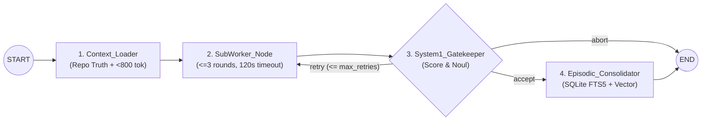

# Hybrid Agent Bridge (`hybrid-agent-bridge`)

**Zero-Container Local-First 4-Tier Memory & System-1 / System-2 Hierarchical LangGraph Orchestration Framework.**

Designed for real-time reliability on consumer/prosumer hardware running local quantized inference servers (**Ollama**, **llama.cpp**, **vLLM**) under strict VRAM and KV-cache constraints.

---

## Architectural Pillars

1. **Zero-Container Local-First Persistence (`LocalMemoryEngine`)**
   - Unifies all 4 memory tiers into a single embedded SQLite file (`~/.agent_bridge/memory.db`) running in **WAL (Write-Ahead Logging)** mode (`synchronous=NORMAL`, `busy_timeout=5000ms`).
   - **Working Memory**: Atomic graph checkpoints via LangGraph's `SqliteSaver`.
   - **Declarative Memory**: `declarative_facts (id, category, key, value_json, updated_at)` with a `UNIQUE(category, key)` constraint and deterministic **Upsert** semantics (*latest data is ground truth*; zero LLM temporal conflict overhead).
   - **Semantic & Episodic Memory**: `episodic_artifacts` indexed via **SQLite FTS5 (BM25)** external-content triggers and CPU-embedded `float32` vectors (`sqlite-vec` + deterministic SQLite cosine similarity UDF). Stores **only** validated `(Task, Final_Artifact)` pairs.
   - **Bounded Context Injector**: Guarantees a hard context budget (`< 800 tokens`) and enforces **Repo Truth Hierarchy > Declarative Memory > Episodic Memory**.

2. **System-1 / System-2 Dualism (`JevDecisionAdapter`)**
   - Generative LLMs (*System 2*) are reserved **exclusively** for artifact synthesis.
   - Routing, memory ingestion classification, compliance validation, and sub-worker stopping conditions are delegated to a typed *System 1* controller implementing:
     - `Choice(state, question, options)` $\rightarrow$ chosen option + normalized Softmax distribution.
     - `Score(state, question, scale_rubric)` $\rightarrow$ normalized scalar in $[0.0, 1.0]$ with AST & anti-placeholder rubric breakdown.
     - `Noul(state, proposition)` $\rightarrow$ epistemic truth probability in $[0.0, 1.0]$.

3. **Deterministic Sub-Worker Isolation (`IsolatedSubWorker`)**
   - Encapsulates exploratory multi-turn synthesis inside `SubWorker_Node` with:
     - Zero shared state with the parent orchestrator.
     - Strict round cap (`max_round <= 3`).
     - Mandatory `120s` wall-clock timeout inside an isolated `asyncio` event loop.
     - Immediate destruction of the internal scratchpad (`scratchpad.clear()`) before returning only the converging artifact.

---

## Macro-FSM Topology



---

## Quick Start (Local-First)

### 1. Installation

```bash
# Create virtual environment with Python >= 3.10 and install in editable mode
uv venv --python python3.11 .venv
source .venv/bin/activate
uv pip install -e ".[dev]"
```

*(Or with standard `pip`: `python3 -m venv .venv && source .venv/bin/activate && pip install -e ".[dev]"`)*

### 2. Initialize the Unified SQLite Engine

```bash
agentic init --seed-defaults
```

### 3. Upsert Declarative Facts & Run the Orchestrator

```bash
# Deterministic Upsert into declarative_facts
agentic memory upsert runtime inference_backend "ollama/qwen2.5-coder:7b"

# Execute the 4-node LangGraph FSM
agentic run "Write a Python function calculate_token_budget that estimates token usage" \
  --fact "constraints:max_tokens=800"

# Inspect unified memory stats, declarative facts, and FTS5/Vector episodic artifacts
agentic memory inspect --query "calculate_token_budget"
```

### 4. Run the Phase 4 End-to-End Demonstration

```bash
python examples/end_to_end_demo.py
```

### 5. Run the Deterministic Test Suite

```bash
pytest -v
```
